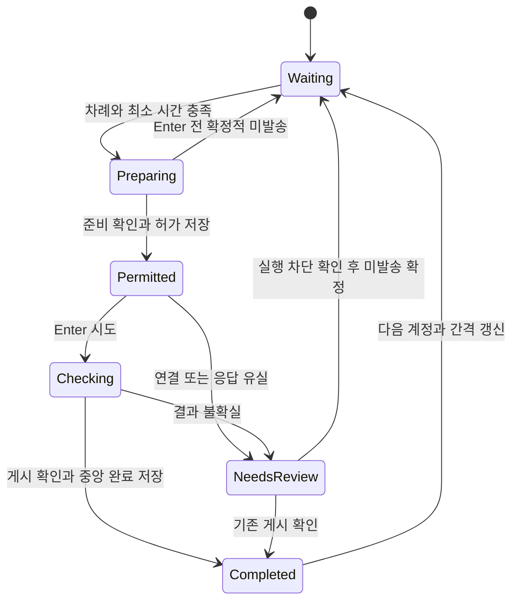

# 중앙관리 기술 설계와 개발 로드맵

작성: 2026-10-30 KST. 제품 방향은 승인됐으며 아래 기술 선택과 수치는 구현을 위한 제안이다. 본 문서는 실행 코드가 아니다.

## 1. 구조와 책임

| 구성 요소 | 책임 | 하지 않는 일 |
| --- | --- | --- |
| 로컬 관리 서비스 | 단일 예약 엔진, SQLite, 발송 허가, 명령·결과 기록, 중앙 UI 제공 | Discord 세션/비밀번호 수집, 직접 개인 계정 API 호출 |
| Native Messaging 브리지 | 설치된 확장에서 서비스 자동 발견·시작, 인증된 명령·이벤트 중계 | 브리지 인스턴스마다 별도 예약 엔진 실행 |
| 중앙관리 페이지 | 개인 메시지·채널·그룹 편집, 실시간 상태·복구 안내 | 자체 타이머로 발송, 다른 브라우저 쿠키 읽기 |
| 확장 service worker | 연결 등록, 구성 수신, 탭 검사, 허가 확인, 상태·결과 보고 | 독립 반복 예약, 중앙 설정에 없는 추가 발송 |
| Discord content script | 특정 탭의 계정·채널·초안 검사, 허용된 문구 입력·게시 확인 | 네이티브 호스트 직접 호출, 연결 키 수신 |

각 브라우저의 네이티브 연결은 서로 다른 브리지 프로세스를 만들 수 있다. 예약 엔진은 OS 사용자별 서비스 하나이며 브리지들은 같은 서비스에 접속한다. 대시보드 역시 여러 탭이 열려도 같은 엔진의 상태를 본다.

연결 채널마다 전용 전송용 탭을 하나 배정한다. 한 확장이 여러 채널에 연결돼도 서로 다른 탭을 사용하며, 탭 ID·연결 ID·채널 ID·현재 발송 ID의 소유권을 잠근다. 준비·발송·재확인 작업은 같은 탭에서 직렬 처리한다. 다른 채널로 전용 탭을 이동·재사용하지 않으며, 미확인 시도가 있는 탭의 소유권을 새 작업에 넘기지 않는다. 일반 Discord 탐색 탭은 실행 탭과 분리한다. 같은 계정·논리 채널이 여러 브라우저에 있으면 실행 담당 하나만 점유할 수 있다.

공통 로직은 TypeScript·Node.js로 작성하고 런타임을 배포 패키지에 포함한다. 관리 UI는 React·TypeScript·Vite 정적 빌드로 제공한다. NestJS/Next.js의 별도 서버 런타임은 초기 범위에서 추가하지 않는다. 저장은 메시지·버전·적용·명령·허가를 하나의 트랜잭션으로 다룰 수 있도록 SQLite로 전환한다. SQLite 드라이버와 런타임 버전은 플랫폼 패키징 시험에서 확정하고 잠금 파일에 고정한다.

기존 Swift/C# 업데이트 도구는 호스트 등록·정식 ZIP 검증·복구 설계를 참고한다. 새 앱의 공통 제품 로직을 Swift로 옮기지 않는다. OS 전용 설치·실행 코드는 최소 어댑터로 둔다. 기존 업데이트 호스트는 업데이트 후 종료하는 구조이므로 그대로 상주 서비스라고 간주하지 않는다.

## 2. 설치·자동 연결

### 일반 사용자 경로

1. 설치 프로그램이 사용자별 데이터 폴더, 관리 서비스, OS별 실행 바로가기와 브라우저용 호스트 매니페스트를 준비한다.
2. 중앙 서비스는 사용자별 프로세스 잠금과 IPC로 단일 실행을 보장한다. 프로그램을 다시 열면 기존 서비스의 대시보드만 연다.
3. 확장은 사용자가 허용한 Native Messaging으로 고정된 호스트 이름에 연결한다.
4. 브리지는 해당 사용자의 IPC로 관리 서비스를 발견하고 없으면 시작한다. 로컬 HTTP 주소를 탐색하거나 내부망을 스캔하지 않는다.
5. 확장 인스턴스와 서비스 세션을 등록하고 필요한 구성·기능 버전을 교환한다. 비밀 키를 사용자가 복사하지 않는다.
6. 정상 연결 후 중앙 목록에 해당 확장이 나타난다. 다음 실행부터 같은 인스턴스를 자동 재연결한다.

호스트의 허용 확장 ID는 배포 채널별로 고정하고 설치 프로그램에 포함한다. 개발용 압축 해제 확장은 별도의 고정 개발 ID와 개발 호스트를 사용한다. 임의 확장이 보낸 ID를 무조건 허용하거나 호스트 allowlist를 와일드카드로 열지 않는다.

브라우저 종류·설치 경로·등록 방식은 어댑터로 관리한다. Chrome·Brave는 기존 등록 코드를 출발점으로 삼되 macOS/Windows에서 각각 새 설치·업데이트·제거를 검증한다. Edge와 다른 Chromium은 공통 API를 쓸 수 있어도 등록 위치와 배포 ID가 같다고 가정하지 않는다. 연결 실패 화면은 실제로 확인된 지원 목록과 정확한 설치 안내를 제공한다.

일반 사용자는 Node.js 설치, 터미널 실행, JSON 설정 편집, IP·포트·토큰·확장 ID 입력을 하지 않는다. OS 설치 확인과 확장 설치/연결 권한 승인은 여전히 사용자 행동이다. 스토어 등록·승인 여부와 서명·공증은 구현과 별개로 출시 전 확인해야 한다.

### OS별 수명 주기

| 항목 | macOS | Windows |
| --- | --- | --- |
| 사용자 데이터 기본 위치 제안 | `~/Library/Application Support/DICO` | `%LOCALAPPDATA%\DICO` |
| 자동 실행 제안 | 사용자 로그인용 LaunchAgent | 사용자 로그인 작업/시작 등록, 패키징 시험에서 하나 선택 |
| 서비스 발견 제안 | 사용자 권한의 Unix domain socket | 사용자 권한의 named pipe |
| 사용자 행동 | 관리 프로그램 열기/종료, 자동 실행 선택 | 관리 프로그램 열기/종료, 자동 실행 선택 |
| 초기 빌드 검증 | Apple Silicon와 Intel | x64 |

로그아웃·절전·브라우저 종료 중에는 정상 발송을 보장하지 않는다. 중앙 페이지 닫기는 서비스 종료와 다르며, 서비스 종료 요청은 모든 새 허가를 막고 진행 상태를 저장한 뒤 처리한다. 브라우저가 닫혀도 서비스는 실행될 수 있지만 실제 발송은 그 브라우저가 연결돼 있어야 한다.

## 3. 중앙 UI 접속과 로컬 경계

HTTP 리스너는 `127.0.0.1`에만 바인딩한다. 설치/실행 프로그램이 충돌하지 않는 포트를 선택하고 서비스 IPC가 현재 주소를 보관한다. 고정 기본 포트가 이미 사용 중이면 다른 포트를 택해도 사용자가 주소를 바꾸지 않게 한다. `0.0.0.0` 바인딩·외부 접속·포트포워딩 설정은 제공하지 않는다.

중앙 페이지 열기는 관리 프로그램 또는 연결된 확장이 요청한다. 서비스가 짧은 수명의 1회용 부트스트랩 값을 발급해 로컬 페이지의 URL fragment에 전달한다. 페이지는 같은 origin의 세션 교환 요청에만 사용하고 URL에서 즉시 제거한다. query string·기록 로그·리퍼러에 연결 비밀을 넣지 않는다. 화면 접속용 세션과 확장 연결 자격은 분리한다.

UI 세션은 host-only·HttpOnly·SameSite 쿠키와 세션에 묶인 변경 요청 검증값을 사용한다. 읽기 이벤트와 변경 API 모두 세션을 검사한다. 변경 요청은 정확한 로컬 origin/Host·세션·CSRF 값을 확인하고 일반 웹사이트의 교차 출처 요청을 허용하지 않는다. loopback HTTP에서 사용할 쿠키 속성은 실제 브라우저로 검증한다. 같은 OS 사용자 권한을 획득한 프로그램까지 이 방법으로 차단한다고 설명하지 않는다.

일반 확장은 네이티브 브리지를 통해 명령을 받아 광범위한 HTTP/HTTPS 호스트 권한을 요구하지 않도록 한다. 필요한 Discord origin만 content script 범위로 유지한다. Discord 페이지의 임의 메시지가 네이티브 명령으로 전달되지 않도록 sender URL·탭·계정 연결·payload를 검증한다.

## 4. 데이터 모델과 버전

| 엔터티 | 핵심 데이터·불변 조건 |
| --- | --- |
| ExtensionInstance | 랜덤 ID, 사용자 지정 이름, 브라우저 종류(확인 가능 시), 버전·기능, 활성 세션 세대, 최근 응답 |
| AccountObservation | 연결 ID, 확인한 Discord 사용자 ID, 관측 시각·확인 방법; 표시 이름을 신원 근거로 쓰지 않음 |
| ChannelBinding | 연결·사용자·서버·채널 ID, 검증 상태; tabId는 재시작 후 재사용하지 않음 |
| Message / MessageRevision | 이름·태그·보관 상태 / 불변 본문 버전과 작성 시각 |
| PlaylistRevision / Item | 채널 적용 목록 버전, 순서 있는 메시지 버전 참조; 1~50개 |
| Group / GroupMember | 논리 채널, 순서 있는 연결 채널, 최소 간격, 구성 버전 |
| RunState | 정지/실행/대기/일시정지/확인 필요, 현재 계정·문구 위치, 다음 조건 |
| DeliveryAttempt | 전역 ID, 계정·채널·문구 스냅샷, 구성 버전, 허가 상태, 관측·게시 근거 |
| Command | commandId, 종류, 대상 세션, 기대 구성 버전, 전달/수신/적용/거절 상태 |
| ResourceLock | 논리 채널과 계정·채널 자원 점유; 충돌 작업 동시 시작 차단 |
| Event | 증가하는 eventId, 대상·종류·시각, 허용된 진단 항목; 비밀 키 제외 |

설정 저장은 기대 버전을 검사한다. 메시지 수정 버전은 불변이고 적용 목록은 해당 버전을 참조한다. 단일 SQLite 트랜잭션에서 발송 허가와 자원 점유를 기록한 뒤 확장으로 보낸다. DB 마이그레이션 전 백업과 schemaVersion을 보관하고 실패하면 읽기/복구 화면으로 전환한다. 손상 DB를 빈 DB로 덮어쓰지 않는다.

## 5. 통신 계약

제품 코드 작성 전에 공유 스키마로 다음 메시지의 필드와 버전을 확정한다. 임의 shell·파일 경로 실행 명령은 제공하지 않는다.

| 종류 | 방향 | 주요 계약 |
| --- | --- | --- |
| HELLO / REGISTER | 확장 → 서비스 | 프로토콜 버전, 인스턴스 ID, 세션 교환, 기능 목록 |
| HEARTBEAT / OBSERVATION | 확장 → 서비스 | 연결 상태, 실제 계정·채널 관측, 적용 구성 버전 |
| CONFIG_SYNC | 서비스 → 확장 | 연결 채널과 적용 목록 버전; 확장의 수신/적용 응답 필요 |
| PREPARE | 서비스 → 확장 | 발송 ID, 준비할 고정 문구, 계정·채널·세션·구성 버전 |
| PREPARED | 확장 → 서비스 | 같은 발송 ID, 초안·계정·채널 확인 결과; Enter 권한 아님 |
| COMMIT_PERMIT | 서비스 → 확장 | 영속 허가 ID, 발송 스냅샷 참조, 현재 세션·구성 버전 |
| DELIVERY_RESULT | 확장 → 서비스 | 확인/미확인/확정적 미발송, 게시 ID·관측 시각·근거 |
| CONTROL / ACK | 양방향 | commandId, 일시정지·중지 등, 수신과 실제 적용을 구분 |
| RECONCILE | 서비스 → 확장 | 기존 발송 ID의 읽기 전용 확인; 새 Enter 금지 |
| UI_EVENTS | 서비스 → 중앙 페이지 | eventId와 현재 상태 버전, SSE 재연결·스냅샷 동기화 |

명령 수신 시 발송 ID와 세션·구성 버전으로 오래된 명령을 거부한다. 확장은 발송 상태를 로컬에 영속화하고 같은 ID의 Enter를 다시 실행하지 않는다. 네이티브 재연결은 메시지가 한 번만 전달된다고 보장하는 장치가 아니다. 중복 전달을 전제로 명령과 결과를 멱등 처리한다.

SSE의 eventId는 화면 복구용이다. 이벤트 보존 범위를 벗어나면 현재 스냅샷을 다시 받고 이후 이벤트를 이어받는다. 상태 반영과 SSE 발행은 outbox 또는 동등한 커밋 후 재전송 구조를 사용해 이벤트 유실이 DB 상태와 화면의 영구 불일치로 남지 않게 한다.

로그·통계·OS 알림은 [로그·그래프·알림 명세](OBSERVABILITY.md)의 같은 이벤트 흐름을 소비한다. 사건별 incidentId, 중복 제거 키, 발송 결과별 집계 버킷·최종 eventId, 알림 전달 시도 이력을 별도로 저장한다. 집계는 원시 로그 개수가 아닌 고유 발송 시도의 상태를 기준으로 계산한다. heartbeat는 상태 구간으로 압축하고 미확인 시도·활성 허가를 로그 보존 작업에서 제외한다.

로컬 관리 프로그램에 OS별 알림 어댑터를 두고 한 처리기만 OS 알림을 보낸다. OS에 알림 요청이 접수된 것과 실제 표시·사용자 열람은 구분한다. 서비스 자체 종료는 실행 관리자/감시 구성 요소가 관측하도록 하며, 감시기까지 종료된 경우 즉시 알림을 보장하지 않는다. 알림 클릭은 사건 상세를 여는 명령만 허용하고 발송 재개·수동 결과 확정을 수행하지 않는다.

## 6. 발송 상태와 중지

0.3.0의 중앙 허가·미확인 보존 원칙을 유지한다. 허가는 자동 만료되지 않는다. 세션이 바뀌었다고 이전 시도가 사라진 것으로 처리하지 않는다. 새 세션에서 이전 발송 ID를 재확인하고 결과가 확정될 때까지 다음 계정 허가를 막는다.

중지 요청은 먼저 서비스의 새 허가를 막고 확장의 로컬 Enter 승인 경로도 닫는다. 진행 중 시도는 확정/미확인으로 분류하고 중지 적용 ACK를 보낸다. 중앙은 전달·수신·적용을 각각 표시한다. 단순히 중지 명령을 큐에 넣거나 시간이 지났다는 이유로 자원 잠금을 풀지 않는다.

취소 ACK는 아직 전달하지 않은 Enter의 차단 근거다. 이미 Enter가 나갔을 가능성이 있으면 취소 ACK만으로 미발송을 결론 내리지 않고 게시 확인을 병행한다. 연결을 잃어 지연 실행을 배제할 수 없다면 미발송 버튼을 막고, 이전 실행 탭 폐쇄 등 확정 절차를 먼저 안내한다.

새 세션 세대는 오래된 요청의 실행을 막는 검증값이며, 진행 중 허가를 자동 폐기하는 장치가 아니다. 엄밀한 exactly-once 게시를 Discord DOM 자동화만으로 보장한다고 설명하지 않는다. 제품의 보장은 한 시도에 대한 중복 실행 차단과 불확실할 때의 보수적 정지다.

### 절전 감지와 시간 계산

서비스가 OS 절전/복귀 통지를 받으면 모든 새 허가를 차단한다. OS 통지가 누락될 때를 대비해 이벤트 루프 관측 공백이 15초를 넘거나 시계 일관성이 깨져도 `재개 필요`로 전환한다. 이 수치는 오탐과 응답성을 시험한 뒤 조정한다. 복귀 시 진행 시도를 그대로 보존하고 연결·계정·채널을 재검사한다. 자동 재연결 성공만으로 허가를 재개하지 않는다. 이미 허가된 시도는 취소·재확인 절차를 거치며, 통지 전후의 지연 Enter 가능성을 단순히 없어진 것으로 처리하지 않는다.

실행 중 최소 간격은 단조 시계의 경과 시간으로 판정한다. 벽시계는 표시·감사 시각으로 별도 저장하고 시스템 시각이 앞으로 바뀌었다고 남은 대기를 단축하지 않는다. 각 중앙 간격과 계정별 대기에는 원래 기간과 마지막 확정 근거를 영속화한다. 재시작/절전 후 단조 시간의 연속성을 확신할 수 없으면 사용자가 재개한 시점부터 남은 조건을 보수적으로 재설정한다. 초기 설계는 마지막 게시가 있는 계정·그룹에 해당 최소 기간 전체를 다시 적용하고, 실제 관측한 더 긴 슬로우 모드도 존중한다. 기다림이 길어질 수 있음을 재개 화면에 알린다.

## 7. 기존 코드의 전환 범위

| 현재 파일·구조 | 유지할 부분 | 바꿀 부분 |
| --- | --- | --- |
| `content.js` | 입력 안정성, 채널 검사, 게시 근거·재확인 | 중앙 발송 ID·세션/버전 검사, 고정 문구 수신 |
| `controller.js` | 미확인 보존·결과 확인 원칙 | A/B 고정과 독립 반복 타이머를 중앙 실행 엔진으로 이전 |
| `channel-manager.js` | 설정 충돌·직렬화 아이디어 | 브라우저 로컬 전체 설정에서 중앙 모델로 이전 |
| `background.js` | 탭 연결·중지 게이트·콘텐츠 통신 | 중앙 명령 실행기와 네이티브 연결, 반복 알람 제거 |
| `coordinator/core.js` | 허가 단일성·완료 멱등·저장 실패 시 차단 | 정적 JSON 그룹에서 동적 DB·실행/구성 버전으로 전환 |
| `coordination.js` | 실패 시 자동 재전송 금지 | 수동 HTTP 주소·토큰 입력 경로를 네이티브 연결로 교체 |
| `popup.html`, `ui.js` | 필요한 연결/상태 확인 행위 | 축소된 확장 화면과 새 중앙 UI로 역할 분리 |
| `updater/` | 정식 ZIP 검증·복구·호스트 등록 경험 | 상주 서비스 설치와 분리, 전체 연결의 작업 상태 확인 |

현재 0.3.0과 새 관리 모드를 같은 계정·채널에서 동시에 실행하지 않는다. 지원 프로토콜이 다른 확장은 신규 허가를 받지 못한다. 단독 반복을 중앙 관리 모드의 대체 수단으로 자동 켜지 않는다.

## 8. 기존 사용자 마이그레이션

1. 중앙 튜토리얼에서 기존 확장 연결과 버전·실행 상태를 수집한다.
2. 기존 실행을 모두 중지하고 준비·미확인·중앙 활성 허가를 표시한다. 미확인 발송은 기존 근거로 먼저 해소한다.
3. 구버전 실행기와 조정기를 정지·전환한 것을 확인한다. 이 조건을 확인할 수 없으면 새 그룹 시작을 막는다.
4. 각 확장의 채널·문구 A/B·다음 문구·주기와 0.3.0 조정기 설정을 가져오기 미리보기로 제공한다. 원본은 백업한다.
5. 채널별 A/B를 보관 메시지 두 개와 적용 목록으로 변환한다. 다음 문구가 B이면 그 위치를 보존한다. 이름은 `채널명 · 기존 문구 1/2`로 생성하고 사용자가 바꿀 수 있다.
6. 문구가 같아도 자동 병합하지 않는다. 원본 인스턴스·채널 ID 기반 가져오기 키로 재시도 중복만 방지한다.
7. 구형 토큰과 브라우저 세션/탭 ID를 새 연결에 재사용하지 않는다. 네이티브 연결과 계정·채널 검증을 다시 완료한다.
8. 새 중앙 상태는 정지로 생성하고 사용자가 요약을 확인한 뒤 시작한다. 구형 엔진의 병행 실행을 금지한다.

### 전환을 허용하는 구체적인 근거

지원되는 자동 전환은 같은 확장 ID의 업데이트로 기존 `chrome.storage.local`을 읽을 수 있는 경우다. 새 확장은 정상 시작 로직보다 먼저 영속 `legacyFrozen` 표시를 저장하고 기존 발송 알람과 구형 시작 경로를 차단한다. 기존 전송 탭에 대한 실행 게이트를 닫고 전용 탭의 종료를 확인하되, Enter가 이미 전달됐을 수 있는 pending은 삭제하지 않고 게시 확인을 요구한다. 불확실한 시도를 해소한 상태 보고, 구형 관리 전용 탭 종료 확인, 중앙 구형 활성 허가 없음이 모두 수집돼야 새 그룹을 시작한다.

0.3.0 조정기는 원격 종료 API가 없으므로 기존 토큰으로 상태를 읽어 활성 허가를 확인하되, 알려진 기존 서비스의 종료는 사용자가 안내대로 수행하도록 한다. 도우미는 기존 상태 폴더의 잠금/PID와 프로세스 종료를 검사하고, 같은 폴더를 배타적으로 전환할 수 있을 때만 최종 상태를 가져온다. 잠금 파일이 있다고 자동 삭제하거나 이름이 비슷한 프로세스를 임의 종료하지 않는다. 종료/허가 상태를 확인하지 못하면 가져오기 미리보기까지 허용하고 실행은 차단한다.

같은 확장 ID 업데이트가 불가능하거나 오래된 버전은 수동 백업 경로를 사용한다. 파일은 메시지·설정 초안만 가져오며 정지 증거가 아니다. 해당 브라우저에서 구형 확장을 비활성화하고 전용 탭 종료를 확인한 뒤 미확인 시도를 해소하며, 도우미가 구형 조정기의 종료와 최종 허가 상태를 확인해야 한다. 자동으로 관측할 수 없는 기존 실행기가 남으면 새 모드 시작을 허용하지 않고 지원 버전으로 먼저 전환하는 안내를 제공한다. 화면의 단순 `중지했습니다` 체크만으로 이를 대체하지 않는다.

새 DB와 기존 JSON의 백업은 앱 설치 폴더 밖에 둔다. 롤백은 모든 진행 시도를 해소하고 서비스를 종료한 뒤 명시적 복원으로 진행한다. 버전만 낮추면서 활성 허가/중앙 명령 이력을 버리는 자동 롤백은 제공하지 않는다.

## 9. 개발 단계와 완료 조건

아래는 기획 수준의 로드맵이다. 실제 파일별 구현 계획과 테스트 코드는 단계 착수 시 작성한다. 기간은 패키징·지원 브라우저 검증 결과 없이 확정하지 않는다.

| 단계 | 결과물 | 완료 조건 |
| --- | --- | --- |
| 0. 자동 연결 검증 | OS별 설치/런타임 묶음, 단일 서비스, Chrome·Brave 브리지 | 깨끗한 macOS·Windows에서 주소·토큰 입력 없이 연결, 포트 충돌·재시작·동일 브라우저 다중 프로필 시험 |
| 1. 중앙 데이터와 관찰 화면 | SQLite·공유 스키마·연결 목록·대시보드·이벤트 | 서비스 종료/복구, 화면 구독 재연결, 저장 실패, 여러 화면 버전 충돌 처리 |
| 2. 메시지와 채널 적용 | 보관함 CRUD·버전·목록·적용 요약 | 단일/복수 문구, 준비 중 수정, 사용 중 삭제, 부분 적용 실패 시험 |
| 3. 중앙 실행 제어 | 그룹 편집·허가·중지·복구·기록 | 순환 100회 지연 시험, 중복 명령·ACK 유실·강제 종료·계정 변경·슬로우 모드 시험 |
| 4. 튜토리얼과 전환 | 기존 설정 가져오기, 도움말·백업·업데이트 | 새 사용자 첫 설정, 기존 B 차례 보존, 미확인 상태에서 마이그레이션 차단 |
| 5. 출시 검증 | OS별 배포본과 지원 표 | macOS 두 아키텍처·Windows x64의 Chrome/Brave 실제 설치·삭제·재설치·절전·업데이트, 승인된 실제 발송 검증 |

로컬 API·브리지·확장 버전이 맞기 전에는 실제 계정에서 시험하지 않는다. 초기 데모 UI도 `실제 연결됨`을 가짜로 표시하지 않고 데모 데이터임을 구분한다.

추가 로그 범위는 단계 1에서 실시간 로그·사건·알림 센터, 단계 3에서 발송 타임라인·지연·결과 그래프, 단계 4~5에서 OS별 알림·빈도 제어·권한·서비스 종료 관측을 포함한다. 전체 인수 기준은 로그 명세 10절을 따른다.

## 10. 주요 검증 항목과 남은 기술 결정

- 패키징: Node.js 별도 설치 없이 네이티브 호스트 실행 가능한가, Windows 바이너리 stdio가 프로토콜을 보존하는가.
- 브라우저: Chrome·Brave 호스트 등록 위치, 확장 배포 ID, MV3 재연결, 프로필별 ID 유지가 OS별로 동작하는가.
- UI: 로컬 세션 부트스트랩·쿠키·Origin 검사, 악성 웹 origin 요청 거절, 여러 화면과 SSE 누락 복구.
- 동시성: 허가/결과 저장 직후 프로세스 종료, 작업 충돌·중복 ID·오래된 구성/세션·중지 ACK 유실.
- 시간·탭: 벽시계 앞/뒤 변경, 절전 통지 누락·긴 관측 공백, 동일 확장 다중 채널, 미확인 탭 재사용 차단.
- 발송기: 현재 기본 아바타의 사용자 ID 검증 제한, Discord DOM 변경 시 안전한 정지. 우회 방식은 검증 전 채택하지 않음.
- 저장: SQLite 드라이버·런타임 버전·백업 방식 확정, 스키마 업그레이드 실패 시 원본 보존.
- 배포: 설치 형식·서명/공증·스토어 배포 경로는 단계 0에서 기술 확인 후 결정. 미서명 개발본과 일반 사용자용 출시본을 구분.

## 11. 근거와 구현 시 참고

- 기존 저장소: `controller.js`, `content.js`, `coordinator/core.js`, `coordinator/server.js`, `auto-update.js`, `updater/main.swift`, `updater/Windows.cs`, `updater/SETUP.md`를 2026-10-30에 확인했다. 현재 구현과 향후 제안을 구분해 위 전환 표에 반영했다.
- [Chrome Native Messaging 공식 문서](https://developer.chrome.com/docs/extensions/develop/concepts/native-messaging): 네이티브 호스트 등록, 허용 확장 ID, 프로세스 수명, service worker와 content script의 권한 경계. 2026-10-30 확인.
- [Microsoft Edge Native Messaging 공식 문서](https://learn.microsoft.com/ko-kr/microsoft-edge/extensions/developer-guide/native-messaging): Chromium 계열이어도 브라우저별 등록·배포 확인이 필요하다는 참고. Edge 정식 지원을 검증했다는 뜻은 아니다. 2026-10-30 확인.

공식 문서는 연결 API와 등록 제약의 근거다. 자동 설치 경험·DB·로컬 세션·기능 구성은 이 제품을 위한 설계 결정이며 공식 문서가 제품 전체의 동작을 보장하는 것은 아니다.

## 12. 설계 검토 기록

별도 검토에서 제품 방향과 구현 가능성을 확인했다. 전송용 탭 소유권, 절전 감지·수동 재개, 구버전 종료의 검증 근거, 단조 시간과 보수적 대기 복구를 보완했다. 수신 ACK와 적용 ACK의 구분 및 기록 보존 기본값도 화면/제품 명세에 반영했다. 새 런타임이나 실제 발송 기능을 검증했다는 의미는 아니다.
