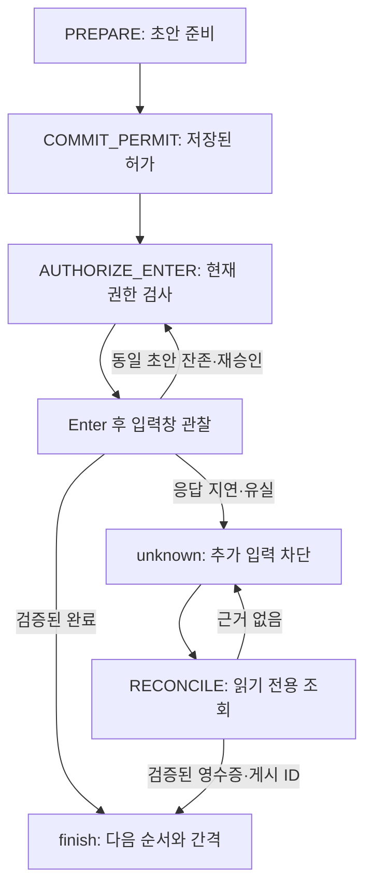

# 발송 실행 경로와 복구 조건 단순화

기준: 2026-11-05 확인한 main `cf18098e12368dd87d83960f333a14b365e6b3a3` (0.4.42).
PR #1의 수정 이후 코드를 대상으로 한다. 11월 4일 운영 관찰은 0.4.41이므로 이 문서의 재현 수치와 운영 수치를 합치지 않는다.
열린 PR #2의 업데이트/롤백 변경과 별도 자동 제보 분석은 포함하지 않는다. 이번 변경은 소스 수정 PR이며 새 릴리스 번호나 운영 적용 완료를 뜻하지 않는다.

## 필수 기능과 실제 소유자

| 요구사항 | 실행 코드 | 보존해야 하는 이유 |
| --- | --- | --- |
| 계정·채널 연결과 검증 | `central/extension/background.js`의 observation, `account-identity.js`, 코어의 HELLO/OBSERVATION/CONFIG_SYNC | 브라우저 프로필과 Discord 계정을 구분하고 현재 탭·세션·설정이 맞을 때만 실행 |
| 그룹 구성과 계정 순서 | `central/core/index.js`의 start/acquire/tick/finish | 같은 계정·채널 자원 중복 실행 방지, 성공 확정 후에만 cursor 진행 |
| 메시지 순서와 편집 | 코어의 playlist/revision/pendingPlaylist, `draft-ledger.js` | 이미 승인한 본문은 불변, 다음 문구는 완료 후 적용, 기존 초안 보존 |
| 발송 간격 | 코어의 monotonic deadline/eligibleChannel/PREPARED/AUTHORIZE_ENTER, content의 slowmode | 그룹 간격·계정 슬로우모드+여유시간을 함께 유지하고 준비 시각과 Enter 시각 구분 |
| 중지·재개 | 코어의 control/controlComplete, 실행기의 volatileStops/stoppedRuns/inputAllowed | 요청 직후 입력 권한 취소, 실제 적용 ACK는 작업 종료 뒤 기록, 사용자 stop/pause 우선 |
| 중복 방지 | 코어 attempt/permit/locks, 실행기 commandJobs/enterRequested/processed, content seenDeliveries/receipt | 명령·응답 재전달과 실제 Enter 재실행을 구분 |
| 완료 판정 | `content.js`의 watchMessage, `delivery-receipt.js`, 코어 DELIVERY_RESULT/finish | 실제 제출한 입력창 비움과 메시지 ID 관찰을 구분하고 unknown을 성공으로 추측하지 않음 |
| 자동 오류 복구 | 준비 실패 재시도, RECONCILE, heartbeat, CONTROL 재발급, 연결 복구 | 일시 오류를 사용자 진단·수동 판정 없이 복구하되 입력 권한은 새로 검증 |

실제 프로세스 진입점은 `central/runtime/main.mjs`다. SQLite 코어와 HTTP/UI·Native Messaging을 연결하고 1초마다 tick한다.
확장 service worker의 진입점은 `central/extension/background.js`이며 5초 heartbeat와 Native push가 같은 명령을 전달할 수 있다.
페이지 실행 코드는 루트 `content.js`에서 빌드하여 `central/extension/content.js`로 배포한다. 루트 파일을 구형 확장 전용이라고 판단해 삭제하면 중앙 실행기도 깨진다.

## 승인부터 완료까지

| 단계 | 중앙 시도 | 확장 시도 | 실제 동작과 다음 단계 조건 |
| --- | --- | --- | --- |
| 차례 예약 | preparing | 없음 → preparing | tick이 한 시도를 만들고 PREPARE 발급. 준비는 지원 확장에서 발송 가능 시각 최대 5초 전 시작 |
| 초안 검사·입력 | preparing | preparing → prepared | DICO_DRAFT_INSPECT → 백업/비교 → DICO_PREPARE. 이 단계에는 Enter 권한 없음 |
| 준비 보고 | preparing → permitted | prepared | PREPARED가 계정·채널·설정·간격을 확인한 뒤 영속 COMMIT_PERMIT 발급 |
| 발송 진입 | permitted | executing, enterRequested=true | 확장이 탭·중지·세션을 재검사하고 기록을 저장한 뒤 DICO_DELIVER를 한 번 호출 |
| Enter 직전 | permitted | executing | content가 같은 초안·현재 계정·슬로우모드·포커스를 검사하고 AUTHORIZE_ENTER를 요청 |
| 같은 초안 재시도 | permitted | executing | DELIVERY_WAIT로 연속 retryCount를 맞추고 매 Enter 전에 다시 승인. 차례/문구는 그대로 |
| 완료 | confirmed | confirmed | 제출한 입력창 비움 영수증 또는 실제 게시 ID. DELIVERY_RESULT 검증 후 finish가 순서·다음 간격을 한 번만 진행 |
| 미발송 확정 | not_sent/cancelled | not_sent/cancelled | 허가 전 준비 실패 또는 명시적 실행 차단 근거. 단순 응답 유실은 미발송 근거가 아님 |
| 결과 미확인 | unknown | executing/unknown/confirmed 중 하나일 수 있음 | 응답 경계의 불일치를 보존. 추가 Enter 금지, 현재 RECONCILE로 저장 영수증/게시 이력만 대조 |

`permitted`와 `executing`은 서로 다른 저장소의 상태다. 하나로 지우면 중앙 허가와 브라우저 호출 시작의 차이를 잃는다.
`enterRequested`도 실제 Enter 완료 횟수가 아니다. DICO_DELIVER 중복 호출 방지용 영속 기록이므로 유지한다.

## 재현한 결함과 변경

### 1. 완료 기록이 있는데 자동 조회가 시작되지 않는 순환 대기

실행기가 DICO_DELIVER 결과를 기다리는 동안 중앙의 30초 진행 관찰 제한이 지나면 중앙만 unknown이 될 수 있다.
이후 실제 완료 영수증이 도착해도 unknown의 입력창 비움 확정에는 **현재 RECONCILE ID와 실행 차단 근거**가 필요하다.
기존 코드는 조회 발급에도 실행 차단 근거를 먼저 요구했고 확정 완료 보고는 그 근거를 보내지 않았다.
그 결과 정상 완료 기록이 남아 있어도 사용자가 stop을 눌러 차단 ACK를 만들기 전에는 복구할 수 없는 경로가 있었다.

변경:

- 읽기 전용 조회는 활성 unknown에 발급한다. 조회 자체는 입력 권한이 아니다.
- 실행기는 기존 binding 작업 뒤에서 조회하고 저장한 완료 또는 정확한 content 영수증을 재보고한다.
- 저장된 confirmed 상태는 이미 로컬 입력 게이트가 닫혔으므로 executionBlocked도 보고한다.
- **unknown의 입력창 비움 확정에 요구하는 현재 조회 ID·동일 세션·제출/동일 입력창/계정/대상 근거 검사는 변경하지 않았다.**
- 근거가 없으면 unknown과 차례·잠금을 그대로 유지한다. 새 탭의 빈 입력창으로 성공을 만들지 않는다.
- 연결에서 detached된 이력은 자동 조회 대상에서 제외한다.

### 2. 조회 대기열의 타이밍이 그룹 실행 의도를 대신하던 조건

메시지 ID가 검증된 결과가 자동 조회 발급 **전에** 도착하면, 기존 finish는 대기 중 RECONCILE이 없다는 이유로 그룹을 paused로 바꿨다.
동일한 결과라도 조회가 먼저 발급됐으면 running으로 복귀했다.

검증된 자동 confirmed 결과는 보존된 같은 run의 실행 의도로 재개한다. 대기 중 명령을 검색하는 파생 조건을 제거했다.
사용자 stop/pause는 재개 의도를 삭제하므로 지연된 완료가 이를 덮지 않는다. 비활성 그룹, 다른 run, 수동 결과 확정, 재시작 후 의도 초기화도 자동 재개하지 않는다.
not_sent 결과만으로는 이 경로에서 재개하지 않는다.

기존 테스트 중 “결과 확정 뒤 paused 그룹의 잠금 해제”는 수동 `attempt.resolve`를 명시하도록 수정했다.
자동 confirmed 후 running인 그룹은 계속 자기 잠금을 가져야 하므로, 기존의 암묵적 수동 재개 기대를 유지하지 않는다.

### 3. 같은 준비 통신 오류가 서로 다른 복구로 갈라짐

DICO_PREPARE 통신 실패인 CONTENT_UNAVAILABLE은 계속 복구했지만, 바로 앞 DICO_DRAFT_INSPECT 통신 실패인 DRAFT_INSPECTION_UNAVAILABLE은 paused로 끝났다.
둘 다 아직 중앙 발송 허가가 없으며, 다음 준비에서는 기존 초안을 다시 검사한다.

DRAFT_INSPECTION_UNAVAILABLE을 기존 5초 준비 재시도에 합쳤다. 4회 실패 후에도 같은 차례·문구로 복구함을 확인했다.
초안 불일치·첨부·백업 한도 등 사용자 입력을 보호하는 차단은 이 오류와 섞지 않는다.

### 4. 조회 실행 전 대기와 조회 응답 유실의 구분

리뷰 중, 새 조회가 아직 반환되지 않은 DICO_DELIVER 뒤에서 기다리면 기존 30초 만료가 queued까지 교체해 새 ID의 조회를 계속 쌓을 수 있음을 확인했다.
기존 발송을 pending으로 둔 실제 실행기 테스트에서 재현했다.

- queued 조회는 같은 ID로 Native/heartbeat가 재전달하고 실행기가 합친다.
- received 조회만 receivedAt부터 30초 뒤 재발급한다. 구기록에 receivedAt이 없으면 createdAt을 사용한다.
- HELLO의 세션 교체 처리는 별도로 기존 명령을 폐기한다.

90초간 기다려도 대기 조회는 1건이며, 수신 후 29초에는 유지하고 30초에는 응답 유실 복구가 시작된다.

## 유지·정리·보류 판단

| 대상 | 판단 | 근거 |
| --- | --- | --- |
| 조회 전 실행 차단 필수 조건 | 제거 | 읽기 전용 요청을 입력 권한처럼 취급하여 완료 보고와 순환 대기 발생 |
| 완료 뒤 대기 중 RECONCILE 존재 여부 | 제거 | 명령 전송 타이밍으로 사용자 실행 의도가 달라짐 |
| 초안 조회 통신 오류의 별도 수동 중단 | 기존 준비 복구에 통합 | 미허가 상태이며 다음 시도도 초안을 다시 검사 |
| queued/received 조회 공통 만료 | 수신 후 응답 제한으로 한정 | 실행 전 대기에 새 명령 ID를 누적시키지 않음 |
| 중앙·실행기·페이지의 중복 방지 기록 | 유지 | 서로 다른 재시작/메시지 유실 경계를 보호하며 역할이 다름 |
| 준비 1초·Enter 직전 500ms 입력 안정 검사 | 유지 | 입력창 재생성·포커스·초안 변화를 검사. 완료 후 500ms 비움 대기와 다름 |
| 2초 승인 신선도·30초 진행 관찰 | 유지 | 오래된 승인과 멈춘 작업을 구분. 제한을 늘려 오류를 숨기지 않음 |
| maxSendRetries의 과거 숫자 필드 | 호환 유지 | 현재 normalizeSendRetries는 null로 이행하지만 저장 기록·프로토콜·UI 진단과 연결됨 |
| 구형 독립 확장·coordinator | 이번 PR에서 삭제 보류 | 중앙 운영의 주 경로는 아니지만 기존 배포/이행 계약과 공유 content 코드가 존재. 미사용 확인 없이 삭제하지 않음 |
| 제보·업데이트·UI 대시보드 | 유지·범위 제외 | 별도 진행 작업이며, 삭제가 이번 발송 결함을 해결한다는 근거 없음 |

단순히 파일 수를 줄이는 대규모 분리는 하지 않았다. 이번 복잡성 감소는 실제 실패를 만든 조건과 잘못 나뉜 오류 분기를 줄이는 데 한정한다.

## 남은 수동/대기 경로와 한계

- 실제 결과를 증명할 영수증과 게시 이력이 모두 없으면 unknown을 유지한다. 자동 조회는 계속하지만 안전하게 미발송으로 단정할 수 없다. 개발자용 `attempt.resolve`/`retryNotSent`는 유지하며 정상 운영의 필수 단계로 새로 추가하지 않았다.
- DRAFT_MISMATCH, ATTACHMENT_OR_REPLY, DRAFT_BACKUP_FULL 같은 준비 차단은 초안·첨부 보존 정책이 필요하다. 자동 삭제나 무조건 입력으로 우회하지 않았다.
- Enter 전 COOLDOWN_UNVERIFIED/COOLDOWN_WAIT_TIMEOUT/deferred가 미발송 완료 후 paused로 이어지는 경로는 남아 있다. 최초 Enter 전·재시도 후의 의미와 실제 DOM 관찰 실패를 분리한 재현 없이 일괄 재시작으로 바꾸지 않았다.
- content 호출 자체가 영구 응답하지 않으면 해당 binding의 실행 종료 ACK도 기다릴 수 있다. 이번 변경은 그 뒤에 동일 조회가 무한 누적되는 것을 막으며 모든 브라우저 정지 원인을 해결한 것은 아니다.
- 최초 로그인·계정 선택·문구 작성과 프로세스 재시작 후 명시 실행은 기존 의사결정 경계다.
- Chrome/Brave 실제 UI, 운영 설치본 적용, 반복 Enter가 최초 거절되는 원인과 운영 재시도율 개선은 미검증이다. Discord에 실제 메시지를 발송하지 않았다.

## 검증

| 항목 | 변경 전 | 변경 후 |
| --- | --- | --- |
| 기존 전체 테스트 | macOS Node 24.14.1, 1,269개 통과 | 1,278개 통과, 실패·스킵 0 |
| 신규 최초 8개 회귀 | 4개 실패: 늦은 완료 조회 미발급, 미차단 unknown 조회 미발급, 확정 결과 후 paused, 초안 조회 오류 후 paused | 8개 통과 |
| 리뷰 중 조회 대기 회귀 | queued 조회 ID 교체로 실패 | queued 90초 유지·received 30초 만료 통과 |
| 기존 핵심 회귀 묶음 | — | 코어·실행기·중지·연결 해제 포함 235개 통과(조회 대기 회귀 추가 전) |
| 실제 코어와 실행기 통합 | — | 가상 시간·Chrome API 경계 대역, SQLite·명령·결과·상태 전이는 실제 코드 |

재현의 31초·90초는 통제한 가상 시각이며 실제 PC 응답시간 개선 측정이 아니다.
로컬 Linux 첫 전체 실행은 esbuild 등 빌드 의존성 부재로 실패했다. 원인 확인 후 의존성이 준비된 독립 macOS 작업 사본에서 main 기준 1,269개 통과를 먼저 확인했다.
최종 코드에서 전체 **1,278개 테스트 통과(실패·스킵 0)**, TypeScript, 프로덕션 UI/확장 빌드, central:check, check, git diff --check를 통과했다. 독립 코드 리뷰에서 발견한 조회 누적 문제를 실패 테스트로 재현·수정한 뒤 관련 경계를 다시 검토했으며 미해결 지적은 없다. 실제 운영 검증과는 구분한다.

기존 운영 자료: [관찰 기록](OBSERVATION-USER-RECOVERY-2026-11-04.md), [0.4.42 수정 기록](STOP-DISCONNECT-RECOVERY-2026-11-04.md), [병합 PR #1](https://github.com/JangKroed/dico-chat-while/pull/1).
